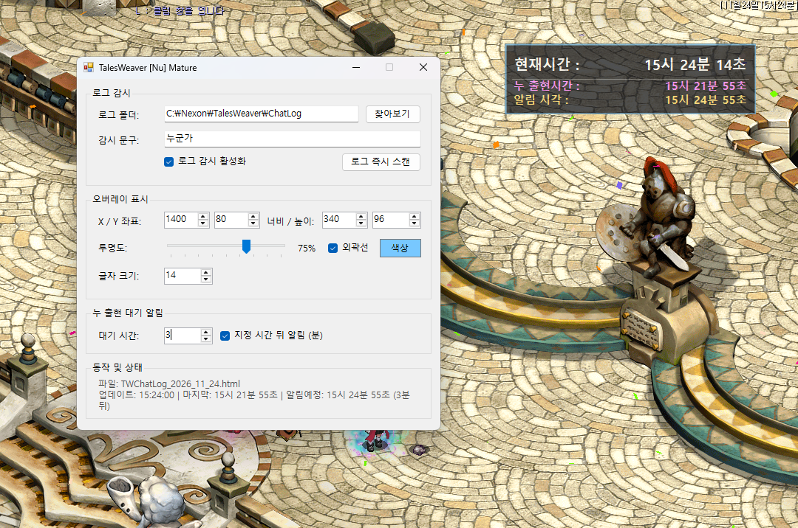

# 🕒 TalesWeaver [Nu] Mature

**TalesWeaver [Nu] Mature**는 온라인 게임 **테일즈위버(TalesWeaver)** 채팅 로그를 실시간 감시하여 **마지막 누 출현시간**과 **현재시간**을 오버레이로 표시하고, 지정 시간 뒤 알림음을 재생해 주는 유틸리티 프로그램입니다.

---

## 🖼️ 소개 및 미리보기 (Preview)

| 메인 설정 창 및 오버레이 화면 |
| :---: |
|  |

* 테일즈위버 채팅 로그를 일일이 확인하지 않고도 현재 시간과 최근 **누 출현시간**을 한눈에 파악할 수 있도록 만든 오버레이 도구입니다.
* 게임 화면 위에 최상단 반투명 창으로 띄워두되, **마우스 투과(`WS_EX_TRANSPARENT`)** 방식으로 동작해 사냥 및 클릭 조작을 방해하지 않습니다.
* 설정 창(**TalesWeaver [Nu] Mature**)에서 로그 폴더, 감시 문구, 오버레이 위치/크기/투명도/글자 크기/외곽선, 출현 대기 알림 시간 등을 직관적으로 조절할 수 있습니다.
* ⚠️ **참고 사항**: 창 모드 및 전체 창 모드(테두리 없는 창 모드)에서만 정상 작동하며, 단독 전체화면 모드는 지원하지 않습니다.

---

## 🚀 시작하기 (Getting Started)

1. **다운로드**: [Releases 페이지](https://github.com/Bad-Factory/TWChatLog_Nu/releases)에서 최신 버전을 다운로드합니다.
2. **실행**: `TWChatLog_Nu.exe` 파일을 실행합니다.
3. **설정**:
   * 테일즈위버 채팅 로그 폴더(`TWChatLog_*.html` 생성 경로)와 감시 문구(기본값: `누군가`)를 확인하거나 변경합니다.
   * 오버레이의 **X / Y 좌표**, **너비 / 높이**, **투명도**, **외곽선 및 색상**, **글자 크기**를 원하는 위치와 스타일에 맞게 조절합니다.
   * 필요 시 **누 출현 대기 알림**에서 대기 시간(분)을 설정하고 알림 체크박스를 활성화합니다.
4. **자동 저장**: 설정 변경 및 프로그램 종료 시 설정값이 `TWChatLog_Nu_settings.json` 파일에 자동으로 저장됩니다.

---

## ✨ 주요 기능 (Key Features)

### 1. 채팅 로그 실시간 감시 및 파싱
* **자동 로그 추적**: 지정한 폴더 내 `TWChatLog_*.html` 파일 중 가장 최근 파일을 자동으로 감지하고 감시 문구를 확인합니다.
* **즉시 스캔 지원**: **[로그 즉시 스캔]** 버튼으로 현재 로그 파일을 즉시 다시 읽을 수 있습니다.
* **감시 토글 및 컴팩트 모드**: **로그 감시 활성화**를 끄면 감시가 중단되고 오버레이 높이가 축소되어 **현재시간**만 표시됩니다.

### 2. 편의 기능
* **실시간 정보 표시**: 오버레이 상단에 **현재시간**, 하단에 **누 출현시간**을 표시하며, 알림 대기 중일 때는 **알림 시각**도 함께 안내합니다.
* **맞춤 오버레이 설정**: 위치(`X / Y`), 크기(`너비 / 높이`), 투명도(`20% ~ 100%`), 외곽선 표시 및 색상, 글자 크기(`9 ~ 48`)를 실시간으로 조정할 수 있습니다.

### 3. 누 출현 대기 알림 및 설정 저장
* **지정 시간 뒤 알림**: 감시 문구가 감지된 출현 시각을 기준으로 설정한 분(1~180분) 경과 시 알림음을 재생합니다.
* **JSON 설정 파일 저장**: 창 위치, 크기, 투명도, 감시 옵션 및 알림 설정이 실행 폴더의 `TWChatLog_Nu_settings.json`에 저장되어 다음 실행 시 그대로 불러옵니다.